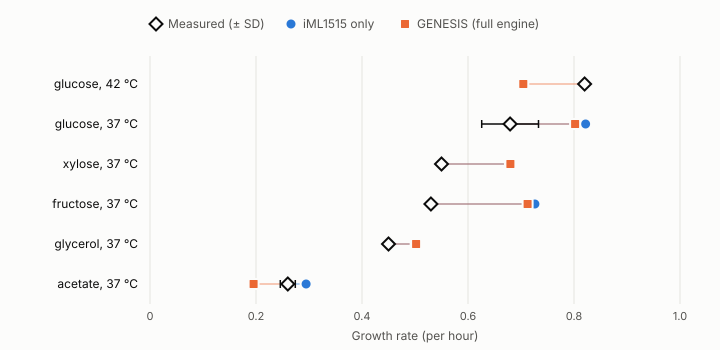

# Growth rate check

**Ground truth:** PRECISE-1K — Lamoureux et al., "A multi-scale expression and regulation knowledge base for Escherichia coli", Nucleic Acids Research 51(19):10176 (2023), doi:10.1093/nar/gkad750; data from github.com/SBRG/precise1k at commit 4829b83, column `Growth Rate (1/hr)` with each experiment's culture conditions.
**Predictions:** iML1515 only, GENESIS (full engine).

## Result

| Engine | Conditions | Mean absolute error (h⁻¹) | Bias (h⁻¹) | Median predicted ÷ measured | Rank agreement (Spearman) | Linear agreement (Pearson) |
| --- | --- | --- | --- | --- | --- | --- |
| iML1515 only | 6 | 0.093 | 0.093 | 1.17 | 0.93 | 0.93 |
| GENESIS (full engine) | 6 | 0.111 | 0.051 | 1.15 | 0.71 | 0.85 |

How to read these: **mean absolute error** is the typical miss in growth-rate units. **Bias** above zero means the engine predicts faster growth than measured on average — expected for flux balance analysis, which assumes the cell grows as fast as its network allows. **Median ratio** is the same idea as a multiple. **Spearman** asks whether the engine puts the conditions in the right order (1 = perfect order), which matters most when only a handful of conditions are available. **Pearson** asks whether the values fall on a straight line.

**Caution — 6 conditions is a small sample.** With this few points a correlation can swing a long way on one condition, so read the rank agreement and each row below rather than leaning on one coefficient. More conditions need more experiments that GENESIS can represent (see the funnel).

## Per condition

| Condition | Experiments | Measured (h⁻¹) | iML1515 only | GENESIS (full engine) | Source |
| --- | --- | --- | --- | --- | --- |
| glucose, 42 °C | 1 | 0.820 | 0.822 | 0.704 | doi.org/10.1093/molbev/msu209 |
| glucose, 37 °C | 3 | 0.679 ± 0.054 | 0.822 | 0.802 | doi.org/10.1038/s41467-019-13483-w doi.org/10.1093/nar/gky752 doi.org/10.1128/AEM.00410-17 |
| xylose, 37 °C | 1 | 0.550 | 0.680 | 0.680 | doi.org/10.1128/AEM.00410-17 |
| fructose, 37 °C | 1 | 0.530 | 0.726 | 0.712 | doi.org/10.1093/nar/gky069 |
| glycerol, 37 °C | 1 | 0.450 | 0.502 | 0.502 | doi.org/10.1128/AEM.00410-17 |
| acetate, 37 °C | 2 | 0.260 ± 0.014 | 0.295 | 0.195 | doi.org/10.1093/nar/gky069 doi.org/10.1128/AEM.00410-17 |

## Carbon uptake limits the engine used

How fast the cell can take up its carbon source sets the ceiling on growth, so these inputs matter more than any other. They come from a separate study, never from the experiments above, so the check cannot grade itself.

| Carbon source | Uptake limit (mmol/gDW/h) | Basis |
| --- | --- | --- |
| acetate | 13.58 | measured — Gerosa et al. 2015, doi:10.1016/j.cels.2015.09.008 |
| fructose | 8.33 | measured — Gerosa et al. 2015, doi:10.1016/j.cels.2015.09.008 |
| glucose | 10.00 | standard value; Gerosa et al. 2015 measured 9.65 |
| glycerol | 10.14 | measured — Gerosa et al. 2015, doi:10.1016/j.cels.2015.09.008 |
| xylose | 9.50 | measured — Gonzalez et al. 2017, doi:10.1016/j.ymben.2016.11.003 |

## Which experiments were used

Each rule is applied in order; the number is how many samples were left after it.

| Rule | Samples left |
| --- | --- |
| all samples in PRECISE-1K | 1,055 |
| growth rate was measured | 339 |
| strain is MG1655 | 309 |
| no gene deletions or other changes | 57 |
| not an evolved strain | 57 |
| M9 minimal medium | 55 |
| ammonium as nitrogen source | 55 |
| oxygen as electron acceptor (aerobic) | 53 |
| no supplements | 21 |
| no antibiotic (no plasmid) | 17 |
| one carbon source that GENESIS supports | 17 |

PRECISE-1K stores one row per sequencing library and repeats each experiment's growth rate on every replicate library, so libraries are first collapsed to one value per experiment. Experiments with the same carbon source, temperature and pH are then averaged into one condition; **Experiments** counts the independent measurements behind each, and ± is their standard deviation.

**Not covered:**
- **Oxygen.** PRECISE-1K reports no growth rates for anaerobic cultures, so this check says nothing about growth without oxygen.
- **pH.** Every usable experiment is at pH 7. The only wild-type experiments at other pH values carry an antibiotic (a plasmid) and are excluded, so GENESIS's pH response is untested here.
- **Temperature.** Only 37 °C and 42 °C are covered.

**Known limitation — overflow metabolism.** On fast sugars (glucose, fructose) the predictions run high. Real E. coli growing fast pushes part of its sugar out as acetate instead of making cells from it; Gerosa et al. 2015 measured 6.83 mmol/gDW/h of acetate on glucose. Flux balance analysis assumes the most efficient use of carbon, so it predicts too little acetate and too much growth. This is a known limit of the method, not a tuning error. It is left visible on purpose: forcing the measured acetate output would improve these rows but hard-code an output the engine should predict. The planned fix is an enzyme-constrained model, which predicts overflow on its own.

---
Generated by `python -m validation.growth_rates` in 15 s. Data: `growth_rates.csv`.
